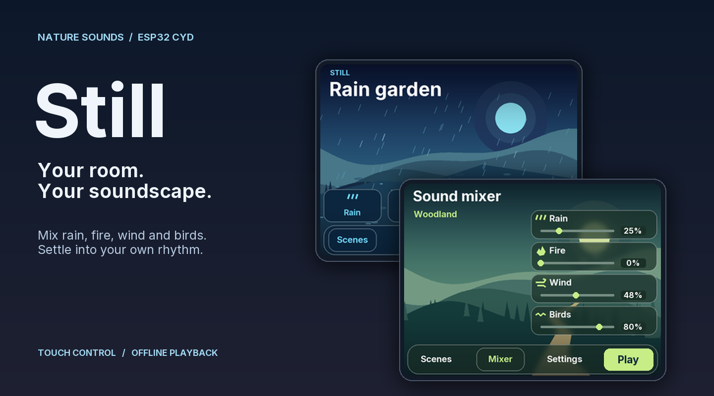
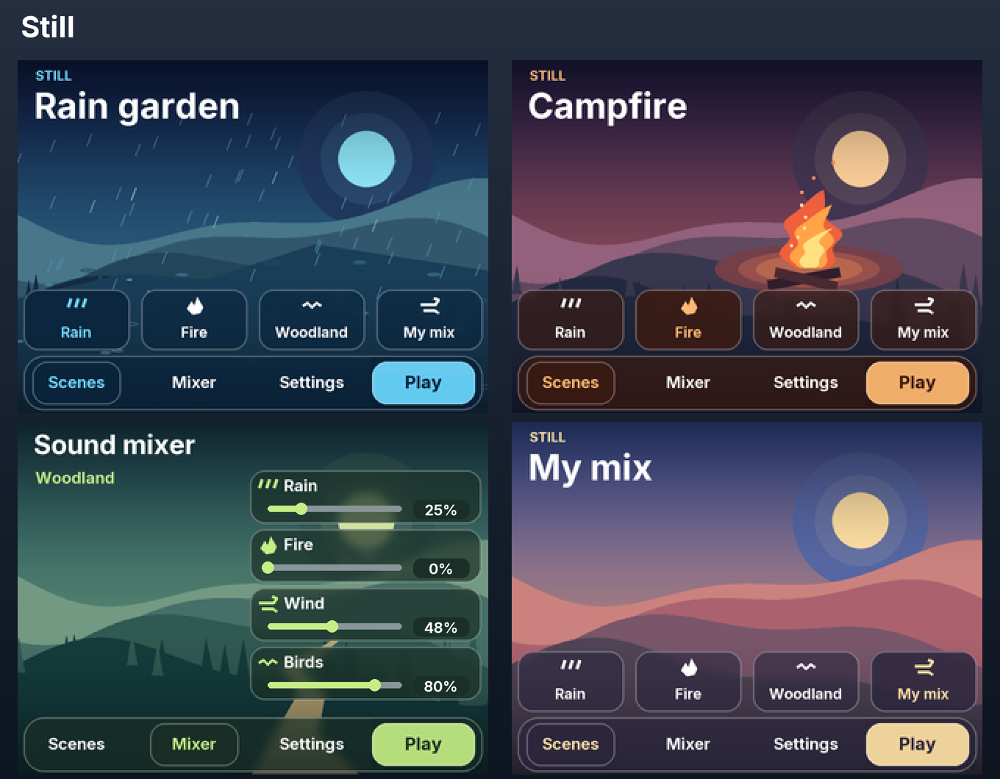

# Still

### A little screen for a quieter room.

A touch-first nature sound mixer for the ESP32 CYD.  
**Rain · Fire · Wind · Birds**

## Make the room sound like your scene

Pick **Rain garden**, **Campfire**, or **Woodland** to start a mix. Open **Mixer** to change each sound independently from 0% to 100%. Save a favorite combination to **My mix**.

The landscape follows your scene through Mixer and Settings. Rain and Campfire have illustrated motion while playing. Woodland and My mix use still landscapes.

*Interface artwork preview rendered from the display assets.*

## Wind down on your own time

- **Mix four sounds at once.** Set each layer and adjust the overall level separately.
- **Set a sleep timer.** Choose 15, 30, or 60 minutes.
- **Pick up where you left off.** Levels and your saved mix stay on the device. Still starts paused.
- **Use it offline.** The artwork lives in internal flash. The four audio loops play from a FAT32 microSD card.

## Get started

1. Download the [ready-built firmware](Still-firmware-v1.0.0.zip) and [SD audio pack](Still-SD-audio-v1.0.0.zip).
2. Follow the [setup guide](SETUP.md) for the 2.8-inch ESP32-32E CYD board.
3. Insert the card, power on over USB, and tap a scene.

The current firmware was built and uploaded to the development CYD. Its onboard artwork was verified at startup. Continuous playback after the latest SD recovery change is pending a hardware check. [دليل الاستخدام بالعربي](GUIDE.ar.md)

[Audio credits and licenses](Card/STILL/Credits.txt) · [Inter font license](Design/Inter-OFL.txt)
